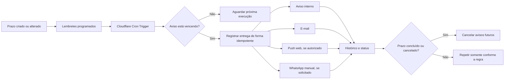

# Sistema de prazos e notificações

> Proposta técnica para o ObrasFlow. Situação dos serviços e franquias consultada em 26/10/2026.

## 1. Objetivo

Avisar a pessoa responsável antes e depois de um prazo importante, usando primeiro os canais que podem operar sem custo adicional:

1. aviso dentro do ObrasFlow;
2. e-mail;
3. notificação do navegador ou celular;
4. link para envio manual pelo WhatsApp.

WhatsApp automático e SMS podem ser acrescentados depois, mas têm cobrança por uso e não fazem parte do MVP gratuito.

## 2. Decisão principal

O ObrasFlow já possui o sino de alertas e a tabela `notificacoes_usuario`. A implementação deve ampliar esse fluxo, sem criar outro centro de notificações independente.

Os registros de negócio continuam sendo a fonte do prazo: obra, etapa do cronograma, conta, cotação, locação ou outro módulo. Um registro de lembrete relaciona a origem, a pessoa responsável e os momentos em que os avisos devem ocorrer.

Não é necessário criar um módulo completo de tarefas para começar. Um lembrete manual pode ser incluído somente quando o prazo não existir em nenhum módulo atual.

## 3. Experiência do usuário

### Cadastro do prazo

Ao criar ou editar um item com prazo, o usuário informa:

- título;
- data e hora;
- responsável;
- prioridade;
- vínculo com obra, cliente, contrato, cotação ou locação;
- antecedência dos avisos, por exemplo: 3 dias antes, 1 dia antes e no vencimento;
- canais permitidos.

O sistema sugere uma configuração padrão e permite remover avisos desnecessários.

### Consulta

A área **Meus prazos** mostra:

- vencendo hoje;
- próximos 7 dias;
- atrasados;
- concluídos;
- filtros por obra, responsável, tipo e prioridade.

O sino existente mostra os avisos mais recentes. Cada aviso abre diretamente o registro relacionado.

### Preferências

Cada usuário escolhe:

- canais habilitados;
- horários em que pode receber avisos;
- se deseja resumo diário;
- antecedência padrão;
- e-mail e celular confirmados.

Um administrador pode definir o padrão da empresa, mas o usuário mantém controle sobre os canais externos permitidos.

## 4. Fluxo do sistema

### Rotina agendada

Uma rotina do Cloudflare Worker executa a cada 15 minutos:

1. busca lembretes pendentes cuja hora já chegou;
2. reserva cada entrega para que duas execuções não enviem o mesmo aviso;
3. cria o aviso interno;
4. tenta os canais externos habilitados;
5. registra sucesso ou erro;
6. repete falhas temporárias com espera progressiva, no máximo três vezes;
7. encerra os lembretes futuros quando o item for concluído ou cancelado.

Datas são salvas em UTC e exibidas no fuso `America/Sao_Paulo`.

## 5. O que pode ser usado gratuitamente

| Recurso | Serviço proposto | Custo | Limite ou condição |
|---|---|---:|---|
| Aviso no sino do sistema | Supabase e interface já existentes | Sem custo adicional | Dentro da franquia do plano atual do Supabase |
| Agendamento | Cloudflare Cron Triggers | Sem custo adicional | Dentro do plano atual; no plano Free há até 5 Cron Triggers e 100.000 requisições/dia |
| E-mail | Resend Free | Gratuito | 3.000 e-mails/mês, até 100 por dia e até 3 domínios |
| Notificação web | Firebase Cloud Messaging (FCM) | Gratuito | O usuário precisa autorizar notificações no navegador; exige configuração de Firebase e service worker |
| WhatsApp manual | Link `wa.me` com texto pronto | Gratuito | Um usuário precisa confirmar o envio; não é automático |
| Banco e histórico | Supabase já utilizado pelo ObrasFlow | Sem custo adicional | Desde que o uso permaneça dentro da franquia contratada |

“Sem custo adicional” não significa capacidade ilimitada. O painel de cada serviço deve ser acompanhado, pois franquias e preços podem mudar.

### O que não é gratuito para operação automática

| Canal | Motivo |
|---|---|
| WhatsApp automático | A API oficial da Meta, diretamente ou por provedor, cobra conforme categoria, destino e volume; também exige cadastro e aprovação de modelos quando aplicável |
| SMS | O provedor cobra por segmento enviado e pode cobrar número e taxas de operadora |
| E-mail acima da franquia | É necessário migrar para um plano pago ou usar outro SMTP com limites próprios |
| Excesso de Cloudflare ou Supabase | O serviço pode bloquear o excedente ou exigir plano pago, conforme o produto e o plano |

Crédito de teste de WhatsApp ou SMS não deve ser considerado gratuito em produção.

## 6. MVP recomendado

### Fase 1 — menor implementação útil

- reaproveitar o sino atual;
- criar a área **Meus prazos**;
- permitir lembretes vinculados aos módulos existentes;
- executar o agendamento pelo Cloudflare Cron Trigger;
- enviar e-mail pelo Resend Free;
- oferecer botão de WhatsApp manual com mensagem pronta;
- registrar entregas, erros e leitura;
- permitir concluir, cancelar e adiar um lembrete.

Essa fase atende avisos internos e externos sem custo enquanto o uso permanecer nas franquias.

### Fase 2 — notificação no navegador

- cadastrar autorização e dispositivo do usuário;
- integrar Firebase Cloud Messaging;
- permitir ativar e desativar cada dispositivo;
- abrir o registro correto quando o usuário tocar na notificação;
- remover inscrições inválidas automaticamente.

### Fase 3 — canais pagos, somente se aprovados

- WhatsApp automático pela API oficial;
- SMS como contingência;
- seleção de provedor por custo, entrega, suporte e conformidade;
- orçamento mensal e limite de gastos antes da ativação.

## 7. Regras padrão de aviso

Configuração inicial sugerida:

- prioridade normal: 1 dia antes e no vencimento;
- prioridade alta: 3 dias antes, 1 dia antes e no vencimento;
- atraso: uma vez por dia útil, no máximo por 5 dias;
- resumo diário opcional às 08:00;
- período silencioso padrão entre 20:00 e 07:00;
- item concluído ou cancelado: nenhum aviso futuro;
- alteração de prazo: cancelar a programação antiga e gerar a nova;
- troca de responsável: avisar o novo responsável e encerrar os avisos do anterior.

Avisos repetidos devem ter uma chave única formada por origem, responsável, canal, tipo do aviso e data programada.

## 8. Dados mínimos

A implementação pode usar as estruturas abaixo, ajustadas ao padrão real das migrations no momento do desenvolvimento.

### `lembretes`

- `id`;
- `empresa_id`;
- `origem_tipo`, por exemplo `obra`, `cronograma`, `conta_pagar`, `cotacao` ou `locacao`;
- `origem_id`;
- `titulo`;
- `descricao`;
- `responsavel_user_id`;
- `vence_em`;
- `prioridade`;
- `status`: `pendente`, `concluido` ou `cancelado`;
- `criado_por`;
- datas de criação e atualização.

### `lembretes_agendamentos`

- `lembrete_id`;
- `canal`: `interno`, `email`, `push` ou `whatsapp_manual`;
- `tipo`: `antecedencia`, `vencimento` ou `atraso`;
- `agendado_para`;
- `status`: `pendente`, `processando`, `enviado`, `erro` ou `cancelado`;
- número de tentativas;
- último erro;
- data do envio.

### Estruturas reaproveitadas ou complementares

- `notificacoes_usuario`: leitura, descarte e estado do aviso interno já existente;
- `preferencias_notificacao`: canais, antecedência, resumo e período silencioso;
- `push_subscriptions`: dispositivos autorizados para receber push.

Todas as tabelas devem usar `empresa_id`, políticas RLS e índices sobre status e data de execução.

## 9. Exemplos de mensagem

### Aviso interno

**Prazo amanhã: vistoria da sala 04**  
Responsável: João — 27/10/2026 às 14:00.  
Ação: abrir locação.

### E-mail

**Assunto:** ObrasFlow — prazo amanhã: enviar medição da Obra 012

O prazo vence em 27/10/2026 às 17:00. Abra o ObrasFlow para consultar e concluir a pendência.

### WhatsApp manual

Olá, João. O prazo “Enviar medição da Obra 012” vence em 27/10/2026 às 17:00. Consulte no ObrasFlow: [link].

Mensagens externas devem conter apenas o necessário. Valores financeiros, documentos e dados pessoais ficam atrás do login.

## 10. Falhas, duplicidade e acompanhamento

- uma entrega não pode ser enviada duas vezes;
- falhas ficam visíveis ao administrador;
- erros temporários têm até três tentativas;
- endereço de e-mail inválido ou inscrição push expirada é desativado;
- o sistema não tenta automaticamente um canal pago como substituto;
- um painel simples mostra quantidade enviada, falhas e uso da franquia;
- o log registra identificadores e status, sem gravar segredos nem conteúdo sensível desnecessário.

## 11. Segurança e LGPD

- exigir consentimento para e-mail opcional, push, WhatsApp e SMS;
- permitir desativar canais a qualquer momento;
- manter chaves do Resend, Firebase e futuros provedores somente em secrets do Cloudflare;
- nunca expor chave de serviço do Supabase no navegador;
- validar empresa e permissões antes de abrir o link de um aviso;
- aplicar RLS a lembretes, preferências, dispositivos e histórico;
- limitar o conteúdo enviado fora do sistema;
- definir prazo de retenção dos históricos;
- registrar quem criou, alterou, concluiu ou cancelou o lembrete.

## 12. Critérios de aceite da implementação

- o responsável recebe o aviso no sino na hora programada;
- o e-mail é enviado quando habilitado e registra o resultado;
- o WhatsApp manual abre com destinatário e texto corretos, sem enviar sozinho;
- dois processamentos simultâneos não duplicam a entrega;
- concluir ou cancelar remove os próximos envios;
- mudar data, responsável ou canais atualiza a programação;
- horários respeitam o fuso de São Paulo e o período silencioso;
- o usuário consegue consultar histórico e preferências;
- RLS impede acesso a lembretes de outra empresa;
- nenhuma chave privada chega ao cliente web;
- os limites gratuitos podem ser acompanhados antes de gerar cobrança.

## 13. Ordem de implementação sugerida

1. Definir as regras finais de antecedência e quem recebe cada tipo de prazo.
2. Criar migration, RLS e testes das regras de agendamento.
3. Integrar **Meus prazos** e o sino existente.
4. Configurar Cloudflare Cron Trigger com envio idempotente.
5. Integrar Resend e acompanhar a franquia.
6. Adicionar WhatsApp manual.
7. Validar em ambiente de teste.
8. Publicar após aprovação e merge da PR correspondente.
9. Medir o uso por 30 dias antes de decidir por WhatsApp automático ou SMS.
10. Adicionar FCM apenas se a equipe considerar o push útil após o MVP.

Cada fase de código ou banco deve ter Issue e PR próprias, conforme o fluxo do projeto.

## 14. Referências oficiais

- [Cloudflare Workers — limites](https://developers.cloudflare.com/workers/platform/limits/)
- [Cloudflare Workers — preços](https://developers.cloudflare.com/workers/platform/pricing/)
- [Resend — preços](https://resend.com/pricing?product=transactional)
- [Firebase — preços, incluindo Cloud Messaging](https://firebase.google.com/pricing)
- [Firebase Cloud Messaging](https://firebase.google.com/products/cloud-messaging)
- [Twilio — preços de mensagens](https://www.twilio.com/pt-br/pricing/messaging)
- [Twilio — preços de SMS no Brasil](https://www.twilio.com/pt-br/sms/pricing/br)
